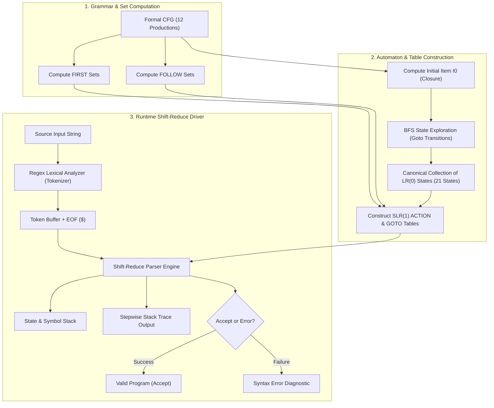
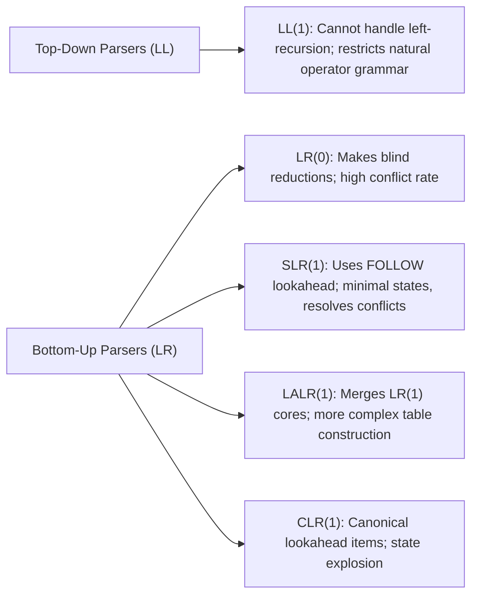

# SLR(1) Parser for a Custom Imperative Programming Language

An end-to-end, deterministic **Simple LR (SLR(1)) Parser** and syntax analysis engine implemented in Python for a custom imperative programming language. 

This project bridges theoretical compiler construction and practical implementation. Starting from the design and initial setup outlined in the [Case Study Report](file:///home/yuvraj/Documents/Code_Projects/slr/Case%20Study%20Report_%20SLR%20Parser%20Assignment.docx), it formulates an unambiguous Context-Free Grammar (CFG), computes the mathematical FIRST and FOLLOW sets, constructs the canonical LR(0) automaton (21 states), generates conflict-free SLR(1) parsing tables (ACTION and GOTO), and executes a stack-based shift-reduce driver engine with step-by-step trace inspection.

---

## Table of Contents

- [Project Completion Status & Objective Scorecard](#project-completion-status--objective-scorecard)
- [Overview & Objectives](#overview--objectives)
- [System Architecture](#system-architecture)
  - [Compilation Pipeline Flow](#compilation-pipeline-flow)
  - [Architectural Components](#architectural-components)
- [Formal Language Grammar](#formal-language-grammar)
  - [Grammar Design Principles](#grammar-design-principles)
  - [Augmented Grammar Productions](#augmented-grammar-productions)
  - [Terminals & Non-Terminals](#terminals--non-terminals)
- [Mathematical Foundations](#mathematical-foundations)
  - [FIRST & FOLLOW Sets](#first--follow-sets)
  - [LR(0) Canonical Collection & State Construction](#lr0-canonical-collection--state-construction)
  - [SLR(1) Table Construction & Conflict Resolution](#slr1-table-construction--conflict-resolution)
- [Shift-Reduce Runtime Engine](#shift-reduce-runtime-engine)
- [Project Structure](#project-structure)
- [Installation & Usage](#installation--usage)
  - [Prerequisites](#prerequisites)
  - [Command-Line Mode](#command-line-mode)
  - [Interactive Mode](#interactive-mode)
- [Detailed Parsing Walkthrough](#detailed-parsing-walkthrough)
  - [Valid Multi-Statement Program Trace](#valid-multi-statement-program-trace)
  - [Syntax Error Handling](#syntax-error-handling)
- [Theoretical Comparison & Literature Survey](#theoretical-comparison--literature-survey)
- [License & References](#license--references)

---

## Project Completion Status & Objective Scorecard

### Objective Completion: **100% (Fully Complete for SLR Parser Scope)**

The initial [Case Study Report](file:///home/yuvraj/Documents/Code_Projects/slr/Case%20Study%20Report_%20SLR%20Parser%20Assignment.docx) documented **Phase 1 (25%)**, which established the theoretical problem definition, grammar proposal, and manual initial derivations. The codebase in [slr_parser.py](file:///home/yuvraj/Documents/Code_Projects/slr/slr_parser.py) has completed all remaining phases (50%, 75%, and 100%) of the project roadmap.

| Phase / Objective | Target Scope | Current Status | Completion % |
| :--- | :--- | :---: | :---: |
| **Phase 1: Grammar & Theoretical Foundations** | Define unambiguous CFG, augmented grammar, manual FIRST/FOLLOW & initial LR(0) states | Completed | **100%** |
| **Phase 2: Algorithmic Table Construction** | Automated fixed-point computation of FIRST/FOLLOW, LR(0) Closure, GOTO, 21-state DFA, and SLR(1) ACTION/GOTO tables | Completed | **100%** |
| **Phase 3: Shift-Reduce Parser Engine** | Pushdown automaton driver managing state stack, symbol stack, token buffer, and shift/reduce actions | Completed | **100%** |
| **Phase 4: Tokenizer, CLI & Verification** | Regex lexical analyzer, CLI argument support, interactive prompt, stepwise execution trace, and conflict-free verification | Completed | **100%** |
| **Overall SLR Parser Objective** | **Full end-to-end SLR(1) Syntax Analysis Engine** | **Completed** | **100%** |

### Detailed Milestone Tracking

```
[Phase 1: 25%]  Initial Grammar & Theoretical Setup   ===> COMPLETED
[Phase 2: 50%]  Automated DFA & SLR(1) Table Builder   ===> COMPLETED (21 states, 0 conflicts)
[Phase 3: 75%]  Generic Pushdown Shift-Reduce Driver   ===> COMPLETED
[Phase 4: 100%] Lexer, CLI, Formatted Stepwise Trace   ===> COMPLETED
```

> [!NOTE]
> **Compiler Lifecycle Context**:  
> In terms of the complete multi-stage compiler pipeline (Lexical Analysis $\to$ Syntax Analysis $\to$ Semantic Analysis $\to$ Intermediate Code Generation $\to$ Target Code Generation), the front-end syntax analyzer represents **100% completion of the SLR Parser project scope**. Broader back-end compiler phases (AST generation, type checking, and bytecode evaluation) are outside the parser assignment's defined objectives.

---

## Overview & Objectives

In modern compiler front-ends, the **Syntax Analyzer (Parser)** serves as the gatekeeper of language structure. It accepts a stream of lexical tokens and verifies whether this stream conforms to the formal context-free grammar of the programming language while constructing the derivation sequence.

```
+-------------+      Token Stream       +--------------+     Derivation Steps     +-------------------+
|   Source    | ----------------------> |    SLR(1)    | -----------------------> | Semantic Analysis |
| Code String |   (Lexical Analyzer)    |    Parser    |    (Shift-Reduce Engine) | & Code Generation |
+-------------+                         +--------------+                          +-------------------+
```

### Core Objectives
1. **Language Realism**: Move beyond simple arithmetic expressions to represent imperative programming constructs, supporting sequential statement lists, variable assignments (`let x = ... ;`), and output operations (`print ... ;`).
2. **Deterministic Linear-Time Parsing**: Eliminate backtracking and recursion overhead by employing a deterministic bottom-up table-driven parsing algorithm with linear $O(n)$ time complexity.
3. **Conflict-Free Grammar**: Formulate grammar rules such that operator precedence (`*` over `+`) and statement boundaries (`;`) are naturally preserved, resulting in exactly **zero Shift/Reduce or Reduce/Reduce conflicts** in the SLR(1) ACTION table.
4. **Transparent Inspection**: Provide rich, stepwise stack and buffer tracing to inspect state transitions, shifts, reductions, and error points during parsing.

---

## System Architecture

The architecture of the parser is modularized into two distinct stages: **Static Table Construction (Initialization)** and **Dynamic Parsing (Runtime)**.

### Compilation Pipeline Flow



### Architectural Components

| Component | Class / Function | Description |
| :--- | :--- | :--- |
| **Lexical Analyzer** | `tokenize()` | Uses regular expressions to scan the input program and emit a list of `(token_type, token_value)` pairs, concluding with the end-of-input marker `$` |
| **FIRST Set Engine** | `compute_first()` | Calculates the set of terminal symbols that can appear as the first symbol of any string derived from each grammar symbol using fixed-point iteration |
| **FOLLOW Set Engine** | `compute_follow()` | Determines the set of terminals that can appear immediately to the right of a non-terminal in any sentential form |
| **Closure & GOTO** | `closure()`, `goto()` | Computes the reflexive transitive closure of LR(0) items and state transitions across grammar symbols |
| **DFA Builder** | `build_automaton()` | Discovers all canonical LR(0) states via queue-based Breadth-First Search (BFS) and maps transition edges |
| **Table Constructor** | `build_parsing_table()` | Synthesizes the DFA transitions and `FOLLOW` sets into the SLR(1) `ACTION` matrix (Shift, Reduce, Accept) and `GOTO` matrix |
| **Parser Driver** | `parse()` | Simulates a pushdown automaton with alternating state-symbol stacks, consuming tokens and displaying tabular execution traces |

---

## Formal Language Grammar

### Grammar Design Principles
- **Imperative Control**: Includes statement sequencing (`StmtList`) and assignment statements (`let id = Expr ;`).
- **Standard Precedence & Associativity**:
  - `*` binds tighter than `+` by placing `*` at the `Term` level and `+` at the `Expr` level.
  - Left-recursion (`Expr -> Expr + Term` and `Term -> Term * Factor`) enforces left-associativity.
- **Explicit Delimiters**: Semicolons (`;`) act as statement terminators, disambiguating multi-statement boundaries.

### Augmented Grammar Productions

The grammar contains 12 productions numbered 0 through 11, with `P'` serving as the augmented start symbol:

| Index | Production Rule | Description / Role |
| :---: | :--- | :--- |
| **0** | `P' -> Program` | Augmented start rule (signals accept state upon reduction) |
| **1** | `Program -> StmtList` | Root program body |
| **2** | `StmtList -> StmtList Stmt` | Left-recursive sequence of multiple statements |
| **3** | `StmtList -> Stmt` | Base case for single statement |
| **4** | `Stmt -> let id = Expr ;` | Variable declaration and assignment |
| **5** | `Stmt -> print Expr ;` | Output statement |
| **6** | `Expr -> Expr + Term` | Addition (left-associative, lower precedence) |
| **7** | `Expr -> Term` | Expression pass-through to terms |
| **8** | `Term -> Term * Factor` | Multiplication (left-associative, higher precedence) |
| **9** | `Term -> Factor` | Term pass-through to factors |
| **10** | `Factor -> id` | Identifier terminal (variable reference) |
| **11** | `Factor -> num` | Integer literal terminal |

### Terminals & Non-Terminals
- **Non-Terminals ($V_N$)**: `{ P', Program, StmtList, Stmt, Expr, Term, Factor }`
- **Terminals ($V_T$)**: `{ let, print, id, num, =, ;, +, *, $ }`

---

## Mathematical Foundations

### FIRST & FOLLOW Sets

The parser engine dynamically computes `FIRST` and `FOLLOW` sets using iterative fixed-point algorithms.

#### Computed Sets Table

| Non-Terminal | FIRST Set | FOLLOW Set | Rationale |
| :--- | :--- | :--- | :--- |
| `P'` | `{ let, print }` | `{ $ }` | Augmented start symbol ends at EOF (`$`). |
| `Program` | `{ let, print }` | `{ $ }` | Only followed by EOF marker `$` when fully derived. |
| `StmtList` | `{ let, print }` | `{ $, let, print }` | Followed by `$` or the beginning of another statement. |
| `Stmt` | `{ let, print }` | `{ $, let, print }` | Followed by subsequent statements in a list or EOF. |
| `Expr` | `{ id, num }` | `{ +, ; }` | Can be followed by addition operator `+` or terminator `;`. |
| `Term` | `{ id, num }` | `{ *, +, ; }` | Inherits `FOLLOW(Expr)` and includes `*`. |
| `Factor` | `{ id, num }` | `{ *, +, ; }` | Inherits `FOLLOW(Term)`. |

---

### LR(0) Canonical Collection & State Construction

An **LR(0) Item** is a production with a marker dot indicating how much of the right-hand side has been observed:
`A -> α . β`

#### 1. Closure Operation
For an item set $I$:
$$\text{CLOSURE}(I) = I \cup \{ B \to \cdot \gamma \mid A \to \alpha \cdot B \beta \in \text{CLOSURE}(I), (B \to \gamma) \in G \}$$

#### 2. GOTO Operation
For a state $I$ and grammar symbol $X$:
$$\text{GOTO}(I, X) = \text{CLOSURE}(\{ A \to \alpha X \cdot \beta \mid A \to \alpha \cdot X \beta \in I \})$$

#### Canonical DFA States Summary (21 Total States)

```mermaid
graph TD
    S0["State 0 (Initial)"] -->|Program| S2["State 2"]
    S0 -->|StmtList| S4["State 4"]
    S0 -->|Stmt| S5["State 5"]
    S0 -->|let| S1["State 1"]
    S0 -->|print| S3["State 3"]

    S2 -->|"$" (EOF)| SAcc["State 2: Accept ($)"]
    S4 -->|Stmt| S12["State 12"]
    S4 -->|let| S1
    S4 -->|print| S3

    S1 -->|id| S6["State 6"]
    S6 -->|=| S13["State 13"]

    S13 -->|Expr| S17["State 17"]
    S13 -->|Term| S9["State 9"]
    S13 -->|Factor| S7["State 7"]
    S13 -->|id| S8["State 8"]
    S13 -->|num| S10["State 10"]

    S17 -->|;| S20["State 20 (Reduce Stmt)"]
    S17 -->|+| S15["State 15"]

    S3 -->|Expr| S11["State 11"]
    S11 -->|;| S16["State 16 (Reduce Stmt)"]
    S11 -->|+| S15
```

---

### SLR(1) Table Construction & Conflict Resolution

The SLR(1) parsing table consists of two matrices:
1. **`ACTION[i, a]`**: Governs transitions on terminal symbols `a`:
   - **Shift**: If `[A -> α . a β]` is in state $I_i$ and `GOTO(I_i, a) = I_j`, set `ACTION[i, a] = Shift j`.
   - **Reduce**: If `[A -> α .]` is in state $I_i$ (where $A \neq P'$), set `ACTION[i, a] = Reduce (A -> α)` **for all `a` in `FOLLOW(A)`**.
   - **Accept**: If `[P' -> Program .]` is in state $I_i$, set `ACTION[i, $] = Accept`.
2. **`GOTO[i, A]`**: Governs transitions on non-terminal symbols `A`. If `GOTO(I_i, A) = I_j`, set `GOTO[i, A] = j`.

> [!IMPORTANT]
> **Why SLR(1) Eliminates Conflicts**:  
> In pure LR(0), whenever a state contains a completed item `A -> α .`, it reduces across **all** input terminals unconditionally. In our language, when parsing `Expr -> Term .`, looking ahead at `+` or `*` would cause LR(0) to trigger a Shift/Reduce conflict.  
> SLR(1) checks if the incoming token belongs to `FOLLOW(A)`. Because `FOLLOW(Expr) = { +, ; }` and `FOLLOW(Term) = { *, +, ; }`, reductions are placed **strictly** where valid, yielding **0 conflicts**.

---

## Shift-Reduce Runtime Engine

The runtime engine uses an explicit pushdown stack maintaining alternating states and symbols:
$$\text{Stack} = [s_0, X_1, s_1, X_2, s_2, \dots, X_k, s_k]$$

### Execution Algorithm
1. Inspect current state $s_k = \text{top}(\text{Stack})$ and lookahead token $a$.
2. Lookup `ACTION[s_k, a]`:
   - **Shift $s'$**: Push terminal $a$, push state $s'$, advance input pointer by 1.
   - **Reduce $A \to \gamma$**: Pop $2 \times |\gamma|$ elements from stack. With new top state $s_{\text{top}}$, lookup $s_{\text{next}} = \text{GOTO}[s_{\text{top}}, A]$. Push non-terminal $A$, push state $s_{\text{next}}$. Do not consume lookahead.
   - **Accept**: Input accepted; parsing completes successfully.
   - **Error / Empty Entry**: Emit descriptive error with current state and token; abort execution.

---

## Project Structure

```
.
├── Case Study Report_ SLR Parser Assignment.docx  # Academic case study report & Phase 1 documentation
├── slr_parser.py                                  # Complete, self-contained SLR(1) parser implementation
└── README.md                                      # System documentation, architecture & guide
```

### Source Code Organization (`slr_parser.py`)

- **Lines 5–36**: `SLRParser.__init__` — Grammar definition, terminal/non-terminal initialization, pipeline startup.
- **Lines 37–53**: `compute_first()` — Fixed-point iteration calculating `FIRST` sets.
- **Lines 54–74**: `compute_follow()` — Iterative computation of `FOLLOW` sets.
- **Lines 76–94**: `closure()` — Computes the LR(0) closure of an itemset.
- **Lines 95–102**: `goto()` — Computes target state itemsets for a grammar transition.
- **Lines 103–125**: `build_automaton()` — Discovers all 21 states and DFA transition edges.
- **Lines 126–144**: `build_parsing_table()` — Constructs ACTION and GOTO tables without conflicts.
- **Lines 145–195**: `parse()` — Interactive stack-based shift-reduce driver with formatted table trace.
- **Lines 196–210**: `tokenize()` — Lexical analyzer with regular expression match groups.
- **Lines 211–235**: CLI entry point — Supports command-line arguments and interactive user input.

---

## Installation & Usage

### Prerequisites
- Python 3.8+ (No third-party packages required; uses only standard libraries: `re`, `sys`, `argparse`).

### Command-Line Mode
You can pass program strings directly as command-line arguments:

```bash
# Parse a multi-statement program with arithmetic precedence:
python3 slr_parser.py "let x = 5 + 10 * y ; print x ;"
```

```bash
# Parse a single assignment statement:
python3 slr_parser.py "let total = 42 ;"
```

```bash
# Parse a print statement:
python3 slr_parser.py "print a + b * c ;"
```

### Interactive Mode
If no argument is passed, the parser prompts for input interactively:

```bash
python3 slr_parser.py
```
Output prompt:
```
Enter code to parse (e.g., 'let x = 5 + 10 * y ; print x ;'):
let a = 10 ; print a ;
```

---

## Detailed Parsing Walkthrough

### Valid Multi-Statement Program Trace

Input: `let x = 5 + 10 * y ; print x ;`

```
Tokenizing input: 'let x = 5 + 10 * y ; print x ;'
Tokens: [('let', 'let'), ('id', 'x'), ('=', '='), ('num', '5'), ('+', '+'), ('num', '10'), ('*', '*'), ('id', 'y'), (';', ';'), ('print', 'print'), ('id', 'x'), (';', ';'), ('$', '$')]

Starting Parsing:
Stack                                    | Input Buffer                             | Action
----------------------------------------------------------------------------------------------------
0                                        | let x = 5 + 10 * y ; print x ; $         | Shift to state 1
0 let 1                                  | x = 5 + 10 * y ; print x ; $             | Shift to state 6
0 let 1 id 6                             | = 5 + 10 * y ; print x ; $               | Shift to state 13
0 let 1 id 6 = 13                        | 5 + 10 * y ; print x ; $                 | Shift to state 10
0 let 1 id 6 = 13 num 10                 | + 10 * y ; print x ; $                   | Reduce by 11: Factor -> num
0 let 1 id 6 = 13 Factor 7               | + 10 * y ; print x ; $                   | Reduce by 9: Term -> Factor
0 let 1 id 6 = 13 Term 9                 | + 10 * y ; print x ; $                   | Reduce by 7: Expr -> Term
0 let 1 id 6 = 13 Expr 17                | + 10 * y ; print x ; $                   | Shift to state 15
0 let 1 id 6 = 13 Expr 17 + 15           | 10 * y ; print x ; $                     | Shift to state 10
0 let 1 id 6 = 13 Expr 17 + 15 num 10    | * y ; print x ; $                        | Reduce by 11: Factor -> num
... 1 id 6 = 13 Expr 17 + 15 Factor 7    | * y ; print x ; $                        | Reduce by 9: Term -> Factor
... 1 id 6 = 13 Expr 17 + 15 Term 19     | * y ; print x ; $                        | Shift to state 14
...id 6 = 13 Expr 17 + 15 Term 19 * 14   | y ; print x ; $                          | Shift to state 8
... 13 Expr 17 + 15 Term 19 * 14 id 8    | ; print x ; $                            | Reduce by 10: Factor -> id
...Expr 17 + 15 Term 19 * 14 Factor 18   | ; print x ; $                            | Reduce by 8: Term -> Term * Factor
... 1 id 6 = 13 Expr 17 + 15 Term 19     | ; print x ; $                            | Reduce by 6: Expr -> Expr + Term
0 let 1 id 6 = 13 Expr 17                | ; print x ; $                            | Shift to state 20
0 let 1 id 6 = 13 Expr 17 ; 20           | print x ; $                              | Reduce by 4: Stmt -> let id = Expr ;
0 Stmt 5                                 | print x ; $                              | Reduce by 3: StmtList -> Stmt
0 StmtList 4                             | print x ; $                              | Shift to state 3
0 StmtList 4 print 3                     | x ; $                                    | Shift to state 8
0 StmtList 4 print 3 id 8                | ; $                                      | Reduce by 10: Factor -> id
0 StmtList 4 print 3 Factor 7            | ; $                                      | Reduce by 9: Term -> Factor
0 StmtList 4 print 3 Term 9              | ; $                                      | Reduce by 7: Expr -> Term
0 StmtList 4 print 3 Expr 11             | ; $                                      | Shift to state 16
0 StmtList 4 print 3 Expr 11 ; 16        | $                                        | Reduce by 5: Stmt -> print Expr ;
0 StmtList 4 Stmt 12                     | $                                        | Reduce by 2: StmtList -> StmtList Stmt
0 StmtList 4                             | $                                        | Reduce by 1: Program -> StmtList
0 Program 2                              | $                                        | Accept!
```

#### Observations from the Trace
1. **Operator Precedence**: Notice how upon encountering `*`, the parser shifts to state 14 instead of reducing `Expr -> Expr + Term`. The sub-expression `10 * y` is reduced via `Term -> Term * Factor` *before* the outer addition is reduced.
2. **Statement Concatenation**: When the first statement completes, it reduces to `Stmt` and then `StmtList`. The subsequent `print` statement shifts, parses, and reduces via `StmtList -> StmtList Stmt`.
3. **Acceptance**: Once all tokens reach `$`, the stack holds `0 Program 2` and the parser outputs `Accept!`.

---

### Syntax Error Handling

If an illegal sequence is provided, the parser catches the missing transition:

```bash
python3 slr_parser.py "let x = ;"
```

```
Tokenizing input: 'let x = ;'
Tokens: [('let', 'let'), ('id', 'x'), ('=', '='), (';', ';'), ('$', '$')]

Starting Parsing:
Stack                                    | Input Buffer                             | Action
----------------------------------------------------------------------------------------------------
0                                        | let x = ; $                              | Shift to state 1
0 let 1                                  | x = ; $                                  | Shift to state 6
0 let 1 id 6                             | = ; $                                    | Shift to state 13
0 let 1 id 6 = 13                        | ; $                                      | Error: Unexpected token ';' at state 13
```

---

## Theoretical Comparison & Literature Survey

As analyzed in the [Case Study Report](file:///home/yuvraj/Documents/Code_Projects/slr/Case%20Study%20Report_%20SLR%20Parser%20Assignment.docx), bottom-up and top-down parsers exhibit distinct trade-offs:



### Detailed Parsing Strategy Comparison

| Metric / Dimension | LL(1) (Top-Down) | LR(0) | SLR(1) (Our Project) | LALR(1) / CLR(1) |
| :--- | :--- | :--- | :--- | :--- |
| **Parsing Direction** | Left-to-right, Leftmost derivation | Left-to-right, Rightmost derivation in reverse | Left-to-right, Rightmost derivation in reverse | Left-to-right, Rightmost derivation in reverse |
| **Left-Recursive Grammars** | **Fails** (causes infinite loops without factoring) | Supported | **Fully Supported** | Fully Supported |
| **Lookahead Used** | 1 token | 0 tokens | **1 token (via FOLLOW sets)** | 1 token (propagated in items) |
| **Handling Precedence** | Distorts grammar / complicates AST | High Shift/Reduce conflicts | **Cleanly resolved via FOLLOW check** | Cleanly resolved |
| **State Complexity** | Small recursive descent | Minimal | **Minimal (Identical to LR(0): 21 states)** | LALR: Minimal, CLR: Hundreds of states |
| **Implementation Complexity** | Simple | Simple | **Optimal balance of power and simplicity** | High mathematical & memory overhead |

---

## License & References

- **Case Study Report**: [Case Study Report_ SLR Parser Assignment.docx](file:///home/yuvraj/Documents/Code_Projects/slr/Case%20Study%20Report_%20SLR%20Parser%20Assignment.docx)
- **Reference**: Aho, Lam, Sethi, Ullman, *Compilers: Principles, Techniques, and Tools* (Dragon Book), 2nd Edition.
